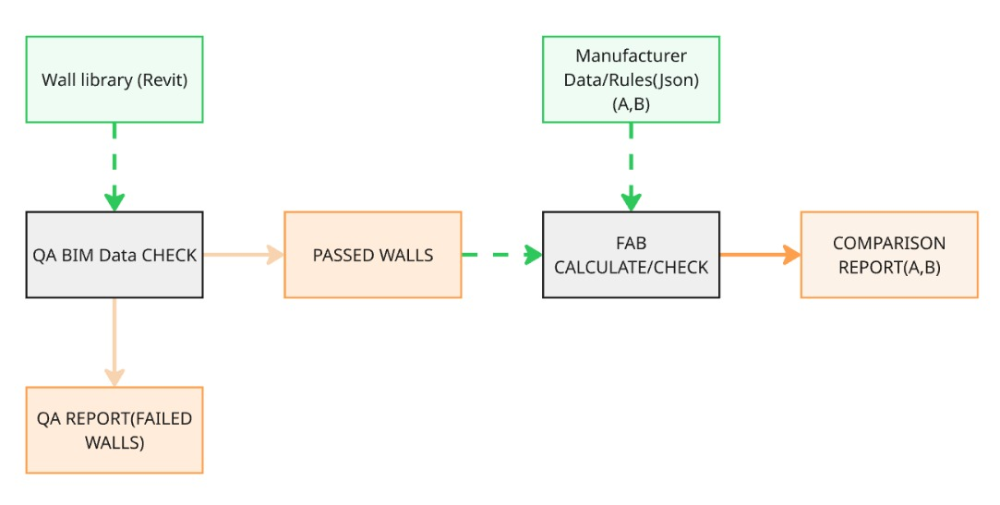

# Design-to-Fabrication: A Workflow Study

A design study on connecting design-stage BIM data to prefabricated wall fabrication: the problem framing, a proposed workflow, and a minimal working core built to test whether the structure holds.

This is a concept study, not a tool. The code is small on purpose.

---

## The problem

In modular construction, design-stage models hold a lot of wall data, but almost none of it is structured for what comes next. Downstream, the same information gets re-derived by hand: panel counts, framing quantities, which walls can actually be produced, how much material is wasted.

Commercial fabrication software handles the downstream half of this well. But those tools sit on the fabricator's side of the handover. Before that point, the design team has little visibility into part counts, repetition, or feasibility, at exactly the stage where those things are still cheap to change.

This study looks at that gap: what would it take to give the design side an early, approximate read on fabrication consequences?

## Proposed workflow



Three stages, each passing plain structured data to the next:

**Validation gate.** Checks whether wall data is reliable enough to compute against: completeness, geometric sanity, relational conditions (openings, neighbours, MEP), consistency across the set. Walls that fail are reported separately rather than silently producing wrong numbers.

**Rule profiles.** Manufacturer constraints as data, not code: spacing, panel dimensions, production limits. Rules come from the manufacturer, so the user selects between profiles rather than authoring them.

**Calculation and comparison.** Quantities and feasibility per wall, aggregated and compared across profiles.

The central design decision is that rules are parameters, not constants. That is what makes comparison possible at all, and it is what the code below exists to verify.

## What was built

`fab_pipeline_core.py`, a minimal end-to-end implementation: mock wall data, a validation gate, two parametric rule profiles, and a comparison loop.

```
python fab_pipeline_core.py
```

Output: pass/fail per wall with reasons, then fabrication quantities for each rule profile side by side.

It is roughly fifty lines. Its purpose is to prove the chain runs and the parametric structure works, not to produce usable numbers.

## What this study does not do

- It does not replace fabrication CAD/CAM software, and is not intended to.
- Current calculations are simplified: no openings, no corners, no waste or nesting. These are the parts that make the comparison genuinely informative, and they are not implemented.
- Rule values are representative, not taken from real manufacturer documentation.
- Nothing has been validated against a real project or real quoted figures.

## Where it would go

In order of value, if continued:

1. **Openings.** Position along and up the wall, feeding both validation and extra framing.
2. **Feasibility limits.** Panel length, height and weight from the profile, flagging walls that cannot be produced as designed.
3. **Material waste.** Real stock sizes, so waste is measured against what gets ordered.
4. **Type classification.** Grouping near-identical walls by fingerprint, so a project of 1200 walls resolves to a few dozen unique types. Repetition is the economics of modular construction and is rarely measured at design stage. This is the piece worth building.
5. **Revit extraction layer.** Last, once the core is stable.

## Status

Paused. Published as a study rather than pushed to a half-finished intermediate state.
